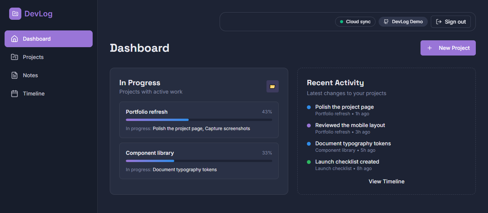
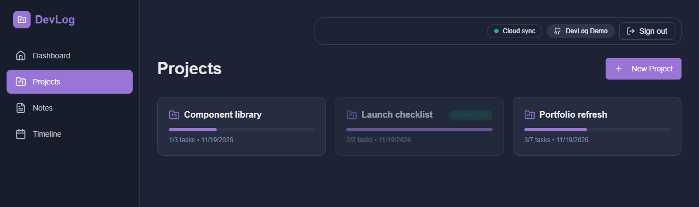
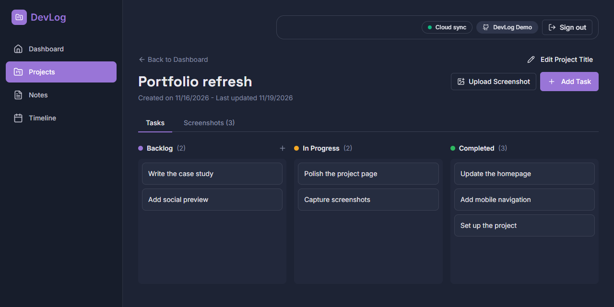
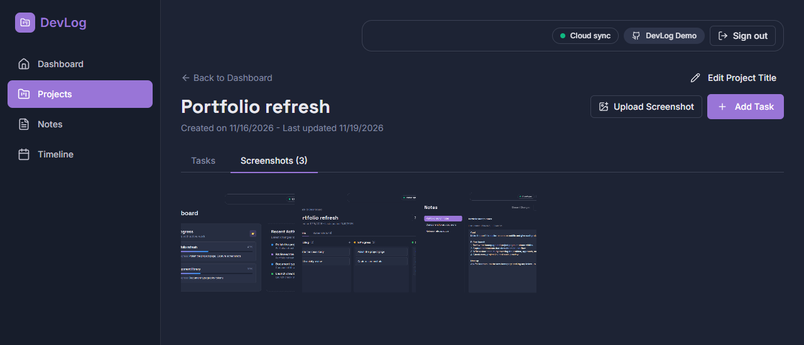
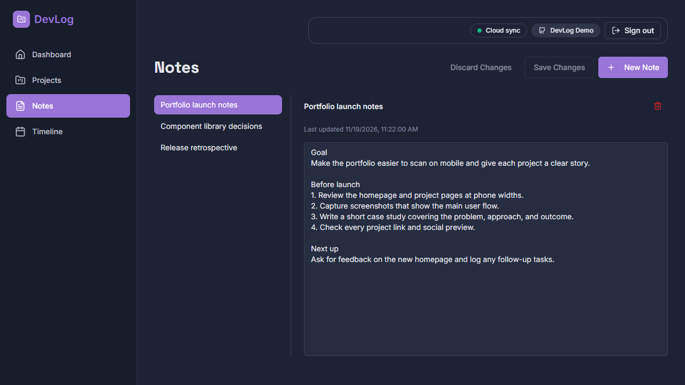
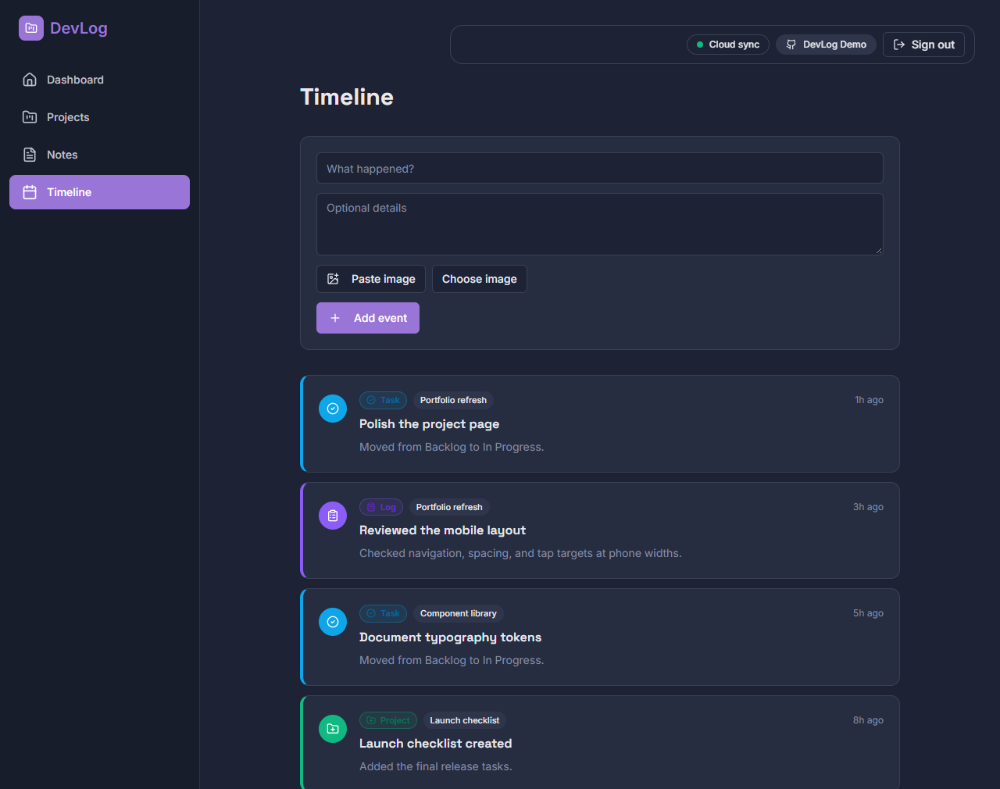

# DevLog

DevLog runs entirely on Cloudflare at runtime: a Hono Worker serves the React
application and API, image objects are stored in the `devlog-screenshots` R2
bucket, and structured data lives in Neon PostgreSQL through Drizzle.

## Features

The screenshots below show DevLog with sample projects, tasks, and notes.

### Dashboard

See active projects, their task progress, and recent activity in one place.



### Projects

Browse your projects and see how many tasks are complete before opening a project.



### Task board

Drag tasks between Backlog, In Progress, and Completed as work moves forward.



### Project screenshots

Save screenshots to a project and open them from its gallery.



### Notes

Keep launch checklists, decisions, and follow-up ideas in the notes editor.



### Timeline

Review project activity and add your own updates with optional image attachments.



## Commands

```bash
pnpm dev
pnpm db:migrate
pnpm build
pnpm worker:deploy
```

`pnpm dev` starts Vite and the Worker together. Vite proxies `/api` and
`/health` to the Worker, while production is same-origin static assets served
by the Worker.

## Neon setup

Set the Worker secrets before deploying. `ALLOWED_USERS` is a comma-separated
list of GitHub logins and/or verified GitHub email addresses. Anyone not on
the list receives a permission-denied response after GitHub sign-in.

```bash
cd apps/backend
wrangler secret put DATABASE_URL
wrangler secret put GITHUB_CLIENT_ID
wrangler secret put GITHUB_CLIENT_SECRET
wrangler secret put SESSION_SECRET
wrangler secret put ALLOWED_USERS
```
